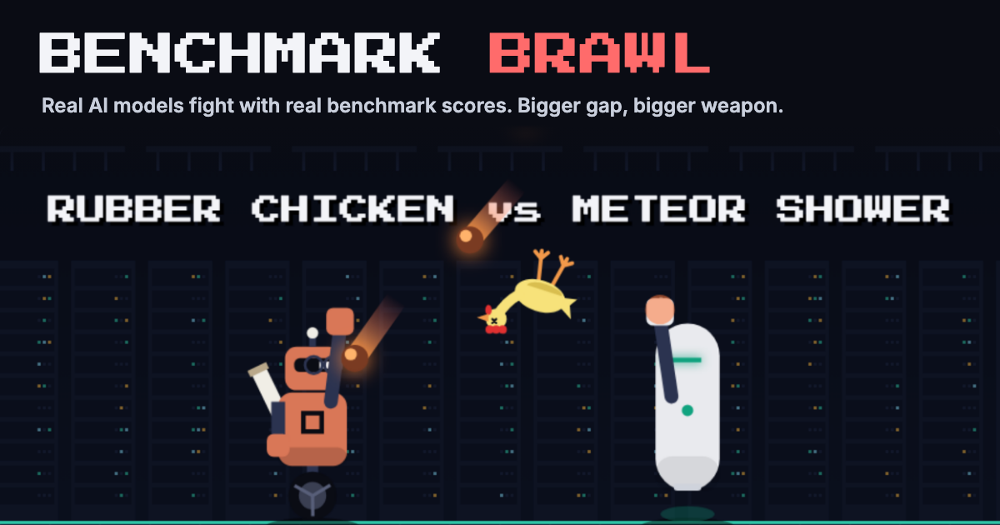
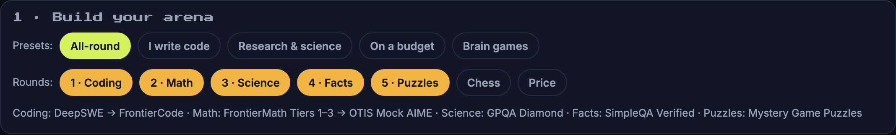
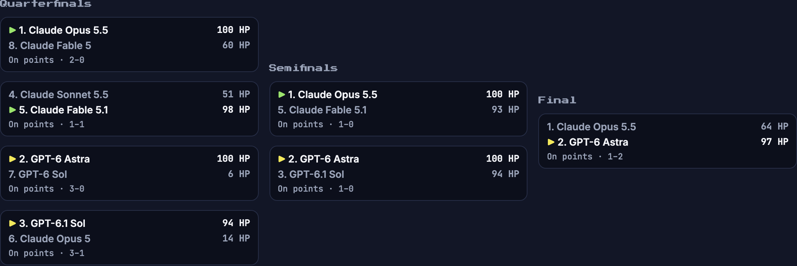
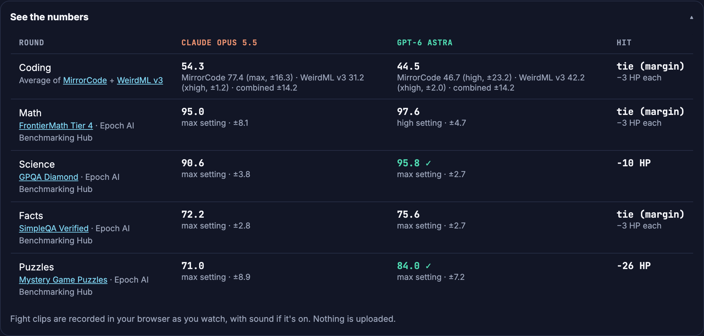

<p align="center">
  
</p>

<p align="center">
  <a href="https://github.com/w20labs/benchmark-brawl/actions/workflows/ci.yml"></a>
  <a href="LICENSE"></a>
  
</p>

**Benchmark Brawl turns AI benchmark tables into fights.** Pick two real models. Every round is a benchmark: the higher score lands the hit, and the bigger the gap, the bigger the weapon, from a machine gun up to an orbital laser. Scores are real, every number links to its source, and a round inside the margin of error is a tie.

## What you can do

| | |
|---|---|
| **Fight** | Any two of ~70 models released in the last year, with real scores from Epoch AI |
| **Build your arena** | Pick 3–7 rounds (Coding, Math, Science, Facts, Puzzles, Chess, Price) or a preset like *I write code* or *On a budget*. The fight answers "which model wins *for me*?" |
| **Price round** | The cheaper model wins; every halving of price is worth a 10-point hit |
| **Weight classes** | Closed vs open weights, and budget / mid / premium by price |
| **Battle royale** | 3 to 8 models in one arena. Each round the best result fires at everyone else; last one standing wins |
| **Tournament** | The top 8 of a weight class, seeded by Epoch Capabilities Index, fought out as a bracket |
| **New challenger** | The newest model (last 30 days) against the champion, on the front page |
| **Claim check** | What each lab published about its own model, next to an independent test of the same benchmark: matches, lab higher, or independent higher |
| **Share** | A Wordle-style result line with a link that replays the same fight, and a **fight clip** (MP4) recorded in your browser |

<table>
  <tr>
    <td width="50%"></td>
    <td width="50%"></td>
  </tr>
  <tr><td colspan="2"></td></tr>
</table>

## Claim check

Labs publish benchmark numbers for their own models. Claim check puts each one next to an independent result for the **same benchmark and version** (Epoch AI's runs, or DeepSWE's own leaderboard, where every model runs in the same agent). If the gap is inside the independent result's margin of error, it's a match.

- The lab numbers are in [`data/claims.json`](data/claims.json), copied by hand from each lab's own announcement, model card or system card, with a link and a short quote. We re-checked a sample against the source pages.
- When a lab names its effort setting, the independent result at that same setting is used, otherwise the best one.
- A gap is not an accusation. Labs often use their own agent setup, more attempts or a different prompt, and the page says so.
- Claims on benchmarks we have no matching independent result for (for example newer Terminal-Bench versions) are left out.

## Signature moves

Every lab has a signature move. It plays in place of the weapon on a model's **biggest hit** of the fight. It's just for fun: the damage is always exactly what the scores say.

| Lab | Move | |
|---|---|---|
| xAI | **Aura Farming** | Strikes a pose, shades drop, golden aura. On a K.O., RATIO |
| Anthropic | **I apologize for the confusion** | Apologizes politely, then throws the apology |
| OpenAI | **Em Dash Barrage** | It rains em dashes. Something about "delve" |
| Google DeepMind | **Two Million Tokens** | Opens a huge context window; the whole library falls out |
| DeepSeek | **Clearance Sale** | A giant 95% OFF tag, and coins everywhere |
| Alibaba | **Release Day** | Fourteen model sizes stampede across the arena |
| Moonshot | **Moonshot** | Launches the moon |
| Z.ai | **Zorro Slash** | Carves a giant Z |
| Thinking Machines | **Deep Thought** | Thinks for 7.5 million years, then throws 42 |
| MiniMax | **Mini → MAX** | A giant version of itself stomps down |
| Nvidia | **GPU Drop** | A graphics card falls from the sky. It's sold out |
| Meta | **Llama Spit** | A llama pops up and spits |
| Mistral | **Mistral** | The cold north wind, literally (ready for when Mistral models join the roster) |
| Everyone else | **Hallucination** | Confidently summons an opponent that doesn't exist |

Moves live in [`src/page/specials.js`](src/page/specials.js). They're affectionate jokes about each lab, not claims about anyone.

## Lab characters

Each lab has its own robot, in colours close to its brand (no logos): Anthropic's clay-orange bot wears reading glasses and carries a scroll, OpenAI's is a sleek white capsule with a green visor line, Google's has twin antennas, xAI's wears shades and a cape, DeepSeek's spouts water, Qwen's has extra arms, Kimi's has a crescent moon, Z.ai's wears a Zorro mask, MiniMax's has a huge head, Nvidia's has a fan in its chest, Thinking Machines' has a glass dome full of gears, and Meta's has llama ears. Flagships (Opus, Pro, Max…) are bigger, fast models (Flash, Haiku, Mini…) smaller, and two models from the same lab get different shades.

## The rules

| Rule | Detail |
|---|---|
| One benchmark per round | A round lists benchmarks in order (Math: FrontierMath Tier 4, then Tiers 1–3, then OTIS Mock AIME). The fight uses the first one **both** models have, so it always compares like with like |
| Coding is averaged | Coding averages the gap over **every** coding benchmark both models have (DeepSWE, SWE-bench Verified, MirrorCode, WeirdML v3), with their margins of error combined. One noisy benchmark can't decide it alone. In a battle royale, Coding uses the single benchmark most fighters have |
| Best reported setting | Each model's best score across its reasoning settings (low, high, max…); the scorecard says which |
| Damage | 2 × the score gap in percentage points |
| Ties | A gap inside the combined 95% margin of error is a tie: no damage. Rounds without a published margin only tie on equal scores, and the game says so |
| Price | Blended list price, (3 × input + output) / 4 per million tokens. Cheaper wins; within 15% is a tie |
| Weapons | Gap 1–4 machine gun · 5–9 rocket launcher · 10–15 meteor shower · 16+ orbital laser |
| Winner | K.O. at 0 HP, otherwise the most HP left. A model can win fewer rounds and still win, if its wins were bigger |
| Battle royale | Each round uses the round's benchmark most fighters have. The best result fires at everyone: 2 × their gap to it, a dodge inside the margin. A fighter without that result sits the round out. 0 HP is out; the last one standing, or the most HP, wins |
| Tournament | Top 8 by Epoch Capabilities Index; 1 v 8, 4 v 5, 2 v 7, 3 v 6; a draw goes to the higher seed |

The rules live in [`src/fight.ts`](src/fight.ts) and [`src/league.ts`](src/league.ts) and are covered by tests.

## Where the numbers come from

| Data | Source | Terms |
|---|---|---|
| Coding (SWE-bench Verified, MirrorCode), Math, Science, Facts, Puzzles, Chess, Capabilities Index, model metadata | [Epoch AI Benchmarking Hub](https://epoch.ai/benchmarks), Epoch's own runs | [CC BY 4.0](https://creativecommons.org/licenses/by/4.0/) |
| Coding: DeepSWE | [Datacurve](https://deepswe.datacurve.ai/), as republished by Epoch AI | Open-source benchmark ([Apache-2.0](https://github.com/datacurve-ai/deep-swe)); results credited to Datacurve |
| Coding: WeirdML v3 | [Håvard Tveit Ihle](https://htihle.github.io/weirdml.html), as republished by Epoch AI. Each model runs in its maker's own coding agent | Credited to the author; no separate license published |
| Claim check: lab claims | Each lab's own announcement, model card or system card (linked per claim) | Short factual quotes, credited |
| Prices | Each lab's own API list price, via [models.dev](https://models.dev) | [MIT](https://github.com/sst/models.dev) |

**Changes we make to Epoch's data:** scores are shown as percentages, each model shows its best reasoning setting, and Coding averages the benchmarks two models share. Third-party hosts' prices are left out on purpose: they often undercut the lab for open-weight models.

The data is rebuilt every morning by [`scripts/build-data.ts`](scripts/build-data.ts). Scores and prices are never edited by hand; the only hand-entered numbers are Claim check's lab claims, each linked to its source. If you spot one that doesn't match its source, please [report it](https://github.com/w20labs/benchmark-brawl/issues/new?template=wrong-number.yml).

**Honest limits.** Benchmarks measure narrow skills, and the newest models aren't on every benchmark yet (a round with no shared benchmark is skipped). We don't use FrontierCode (its publisher's terms don't allow republishing) or Terminal-Bench (Epoch's copy is the older 2.0 version and stops in March 2026). There is no speed round: we found no free, independent speed data whose terms allow reuse.

Visits to the site are counted anonymously with [GoatCounter](https://www.goatcounter.com/) (no cookies, no personal data).

Benchmark Brawl is independent and not affiliated with any AI lab, Epoch AI, Datacurve, WeirdML or models.dev.

## Run it locally

You need **Node.js 24** (`nvm use`).

```sh
npm install
npm run data        # fresh scores and prices (-- --cached reuses data/cache)
npm run build       # writes _site/index.html
open _site/index.html
```

| Command | What it does |
|---|---|
| `npm run typecheck` / `npm test` | Type-check and unit tests (rules, league, data sanity) |
| `npm run test:e2e` | Browser tests on desktop and phone sizes (`npx playwright install chromium` once) |
| `node scripts/make-og.mjs` | Regenerates the link preview image from a real fight |

## Contributing

Bug reports, wrong-number reports and ideas are welcome as [issues](https://github.com/w20labs/benchmark-brawl/issues/new/choose). Pull requests are limited to the project's collaborators; see [CONTRIBUTING.md](CONTRIBUTING.md).

## License

Code: [MIT](LICENSE). Scores: Epoch AI, CC BY 4.0, plus the terms of the original sources listed above.
