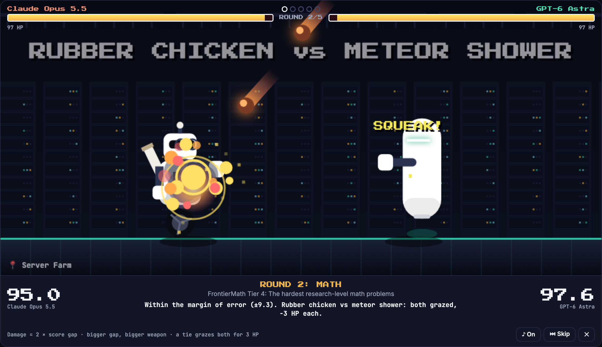
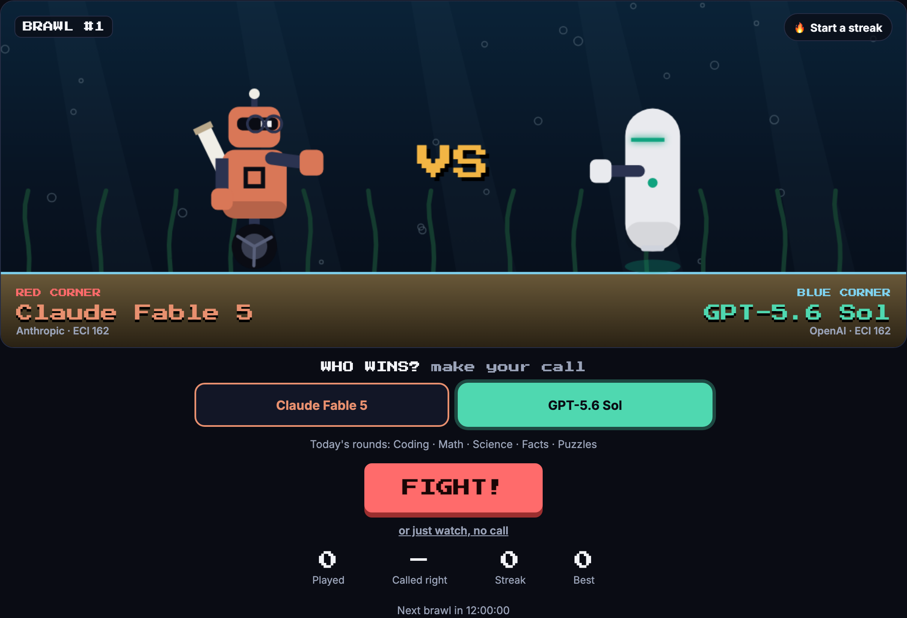
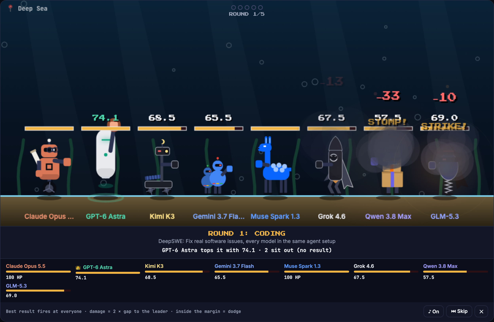
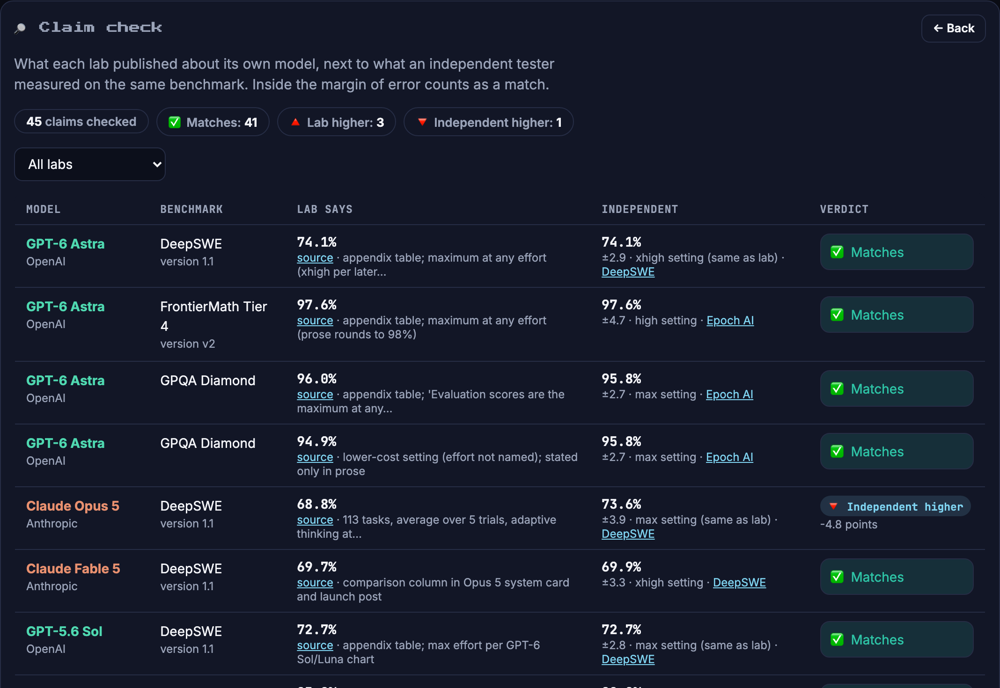

<p align="center">
  <a href="https://w20labs.github.io/benchmark-brawl/"></a>
</p>

<p align="center">
  <a href="https://w20labs.github.io/benchmark-brawl/"></a>
  <a href="https://github.com/w20labs/benchmark-brawl/actions/workflows/ci.yml"></a>
  <a href="LICENSE"></a>
  <a href="https://epoch.ai/benchmarks"></a>
</p>

**Real AI models fight with real benchmark scores.** Every round is a benchmark: the higher score lands the hit, and the bigger the gap, the bigger the weapon, from a rubber chicken to an orbital laser. Every number links to its source, and a gap inside the margin of error is a tie.

### ▶ [Play Benchmark Brawl](https://w20labs.github.io/benchmark-brawl/)

## What's in it

| | |
|---|---|
| **Today** | One official fight a day, the same for everyone. Call the winner, keep a streak, share your result |
| **Free play** | Any two of ~70 models from the last year, over 3–7 rounds you pick, or a preset like *I write code* |
| **Battle royale** | Up to eight models in one arena. Each round, the best result fires at everyone else |
| **Tournament** | The top eight of a weight class (open weights, budget, premium…) fought out as a bracket |
| **Claim check** | What labs publish about their own models, next to independent tests of the same benchmark |
| **Share** | A Wordle-style result line, a share card, or an MP4 fight clip recorded in your browser |

<table>
  <tr>
    <td width="50%"></td>
    <td width="50%"></td>
  </tr>
  <tr>
    <td width="50%"></td>
    <td width="50%"></td>
  </tr>
</table>

## How a fight works

| | |
|---|---|
| **A round** | One benchmark: the first one in the round that both models have, so it's always like for like. Coding averages every coding benchmark the two share |
| **A score** | Each model's best result across its reasoning settings; the scorecard says which |
| **A hit** | 2 × the score gap, in whole HP |
| **A tie** | Equal scores, or a gap inside the combined 95% margin of error. Both fighters are grazed for 3 HP (never a knockout) |
| **Price** | Blended list price, (3 × input + output) / 4 per million tokens. Cheaper wins; within 15% is a tie |
| **The winner** | A K.O. at 0 HP, or else the most HP **by decision**: unanimous if it also won more rounds, split if not |

A round where the two share no benchmark is left out, rather than played empty. In a **battle royale**, each round uses the benchmark most fighters have; anyone inside the leader's margin dodges, and anyone without a result sits out. A **tournament** seeds the top eight by Epoch Capabilities Index (1 v 8, 4 v 5, 2 v 7, 3 v 6), and a draw goes to the higher seed.

**Weapons** show the size of the gap. No weapon is used twice in a fight, and in a tie the two throw different things: one cheeky, one big.

| Gap | Weapons |
|---|---|
| 1–4 | boxing glove, pie in the face, water balloon, rubber chicken, boomerang, slingshot, token spray |
| 5–9 | rocket launcher, grenade, plasma ball, bowling ball, drone strike, cannonball |
| 10–15 | meteor shower, lightning storm, missile swarm, piano drop, tornado |
| 16+ | orbital laser, space anvil, black hole, giant foot |


The rules live in [`src/fight.ts`](src/fight.ts), [`src/royale.ts`](src/royale.ts) and [`src/league.ts`](src/league.ts), and are covered by tests.

## The cast

Each lab has its own robot, in colours close to its brand (no logos), and a signature move that plays on its biggest hit. Moves are just for fun: the damage is always what the scores say.

| Lab | Robot | Signature move |
|---|---|---|
| Anthropic | Rides one wheel, wears reading glasses, carries a scroll | **I apologize for the confusion**, then throws the apology |
| OpenAI | A sleek hovering capsule | **Em Dash Barrage**: it rains em dashes |
| Google DeepMind | Twin bots, side by side | **Two Million Tokens**: a context window opens and a library falls out |
| xAI | A rocket on mech legs, with shades and a cape | **Aura Farming**: strikes a pose; on a K.O., RATIO |
| DeepSeek | A whale on robot legs | **Clearance Sale**: a giant 95% OFF tag, coins everywhere |
| Alibaba (Qwen) | A walking stack of delivery boxes | **Release Day**: fourteen model sizes stampede across |
| Moonshot (Kimi) | A lunar rover with a crescent moon | **Moonshot**: launches the moon |
| Z.ai | A masked egg on a pogo spring | **Zorro Slash**: carves a giant Z |
| MiniMax | A giant head on tiny legs | **Mini → MAX**: a giant version of itself stomps down |
| Nvidia | A walking graphics card | **GPU Drop**: a graphics card falls from the sky, sold out |
| Thinking Machines | A brain in a jar on a tripod | **Deep Thought**: thinks for 7.5 million years, throws 42 |
| Meta | A four-legged llama mech | **Llama Spit** |
| Mistral | A swirling wind cloud with a scarf | **Mistral**: the cold north wind |
| Anyone else | The plain robot | **Hallucination**: summons an opponent that doesn't exist |

Flagships are bigger and fast models smaller. Each fight takes place in one of eight arenas, picked by the matchup: Neon City, Server Farm, Moon Base, Synthwave, Dojo, Volcano, Deep Sea or Snow Peak. All of this is affectionate fun, not a claim about anyone.

## Overfit FC: title belts (Season 2, not started yet)

Benchmark Brawl presents Overfit FC: title belts won and defended in real fights. It's built but switched off until a start date is set (`SEASON_START` in [`src/titles.ts`](src/titles.ts)). Until then nothing of it shows on the site.

| Rule (v1.2) | |
|---|---|
| Belts | **Undisputed** (any model) and **Open weights** |
| Championship rounds | Coding, Math, Science, Facts, Puzzles, always all five |
| Eligible | In the belt's class, with results in at least 4 of the 5 rounds |
| Opening | Each belt opens with an 8-model tournament: the highest-ranked field where every pair can be compared and hasn't met |
| Title night | Every Sunday (UTC), alternating between the open belts. With no possible challenger, the belt waits and Sunday is a normal daily brawl |
| Contenders | The top 3 eligible models by Epoch Capabilities Index, champion excluded. **New in v1.2:** a newcomer with no index yet qualifies by strictly beating the #3 of them on the five rounds, on at least 3 comparable rounds. A draw doesn't qualify, and with no #3 or too few comparable rounds it waits for an index. This check isn't a fight on record |
| Who gets the shot | Newcomers first (models eligible for this belt for the first time), earliest arrival on our roster first, then by id; models already on the roster when arrival tracking began count as earliest. Then the other contenders by index |
| Booking | The two must share at least 3 comparable rounds, and never meet twice on the same scores (openings and other belts included) |
| Draw | The champion keeps the belt |
| Vacancy | A champion who leaves the roster or the class gives up the belt; the two highest-ranked contenders who can fight and haven't met fight for it |
| History | Every entry is saved once, with both fighters' scores and the rules version it was written under, so later score updates never change a reign |

New arrivals are announced on Today for a week (🆕 NEW CHALLENGER), with their title shot once it's booked.

## Claim check

Labs publish benchmark numbers for their own models. Claim check puts each one next to an independent result for the **same benchmark and version**, and calls it a match if the gap is inside the independent result's margin of error.

- Lab numbers are in [`data/claims.json`](data/claims.json), copied by hand from each lab's announcement, model card or system card, each with a link and a short quote.
- When a lab names its effort setting, the independent result at that setting is used. When it isn't available, the row says the settings differ.
- A gap is not an accusation: labs often test with their own agent setup, more attempts or a different prompt.

## Where the numbers come from

| Data | Source | Terms |
|---|---|---|
| Math, Science, Facts, Puzzles, Chess; Coding (SWE-bench Verified, MirrorCode); Capabilities Index | [Epoch AI Benchmarking Hub](https://epoch.ai/benchmarks), Epoch's own runs | [CC BY 4.0](https://creativecommons.org/licenses/by/4.0/) |
| Coding: DeepSWE | [Datacurve](https://deepswe.datacurve.ai/), as republished by Epoch AI | Open-source benchmark ([Apache-2.0](https://github.com/datacurve-ai/deep-swe)); results credited |
| Coding: WeirdML v3 | [Håvard Tveit Ihle](https://htihle.github.io/weirdml.html), as republished by Epoch AI | Credited to the author |
| Prices | Each lab's own API list price, via [models.dev](https://models.dev) | [MIT](https://github.com/sst/models.dev) |
| Lab claims | Each lab's own pages, linked per claim | Short factual quotes, credited |

**What we change:** scores are shown as percentages, each model shows its best reasoning setting, and Coding averages the benchmarks two models share. Third-party hosts' prices are left out, as they often undercut the lab's own price for open-weight models.

**How it stays honest:**

- The data is rebuilt every morning by [`scripts/build-data.ts`](scripts/build-data.ts). Scores and prices are never edited by hand.
- The build checks the sources' shape and values. If anything looks wrong (a missing column, a score that isn't a number, a round suddenly empty), it refuses, and the site keeps the last good data.
- Each daily brawl is saved with a snapshot of both fighters, so a later refresh can't change its result. A `#today=12` link replays it for 30 days, under the current rules.

**Honest limits:** benchmarks measure narrow skills, and the newest models aren't on every benchmark yet. There's no speed round: we found no free, independent speed data that allows reuse. We don't use FrontierCode (its terms don't allow republishing) or Terminal-Bench (Epoch's copy is an older version).

Spot a number that doesn't match its source? Please [report it](https://github.com/w20labs/benchmark-brawl/issues/new?template=wrong-number.yml).

## Run it locally

You need **Node.js 24** (`nvm use`).

```sh
npm install
npm run data        # fresh scores and prices (-- --cached reuses data/cache)
npm run build       # writes _site/index.html
open _site/index.html
```

| Command | What it does |
|---|---|
| `npm run typecheck` · `npm test` | Type checks and unit tests: the rules, the data checks, the build on synthetic sources |
| `npm run test:e2e` | Browser tests at desktop and phone sizes (`npx playwright install chromium` once) |
| `npx tsx scripts/make-images.ts` | Regenerates the link preview and these screenshots from the built page |

## Contributing

Bug reports, wrong-number reports and ideas are welcome as [issues](https://github.com/w20labs/benchmark-brawl/issues/new/choose). Pull requests are limited to the project's collaborators; see [CONTRIBUTING.md](CONTRIBUTING.md).

## License

Code: [MIT](LICENSE). Scores: Epoch AI, CC BY 4.0, plus the terms of the original sources above.

Benchmark Brawl is independent and not affiliated with any AI lab, Epoch AI, Datacurve, WeirdML or models.dev. Visits are counted anonymously with [GoatCounter](https://www.goatcounter.com/) (no cookies).
